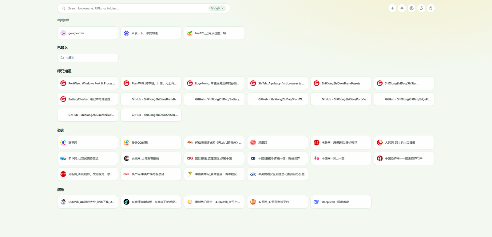
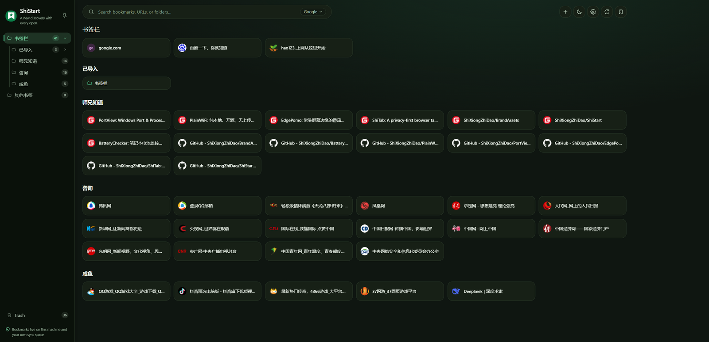
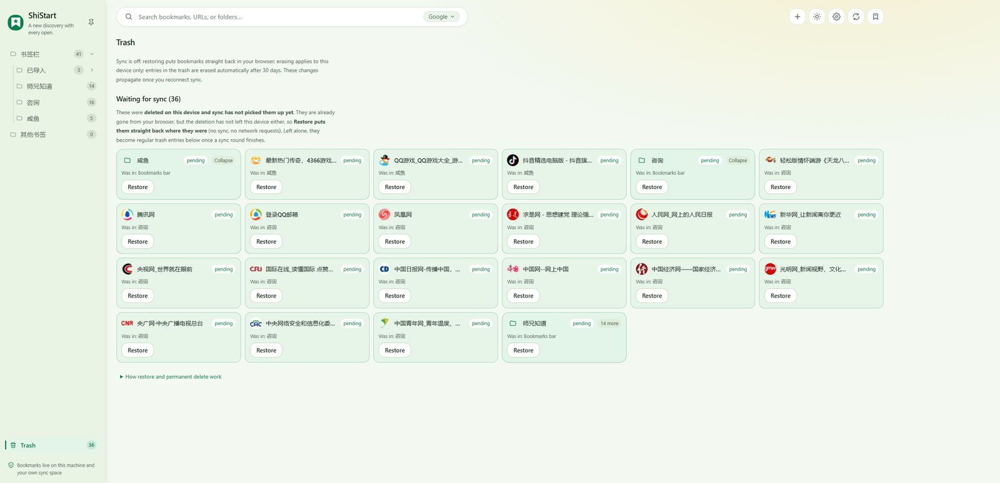
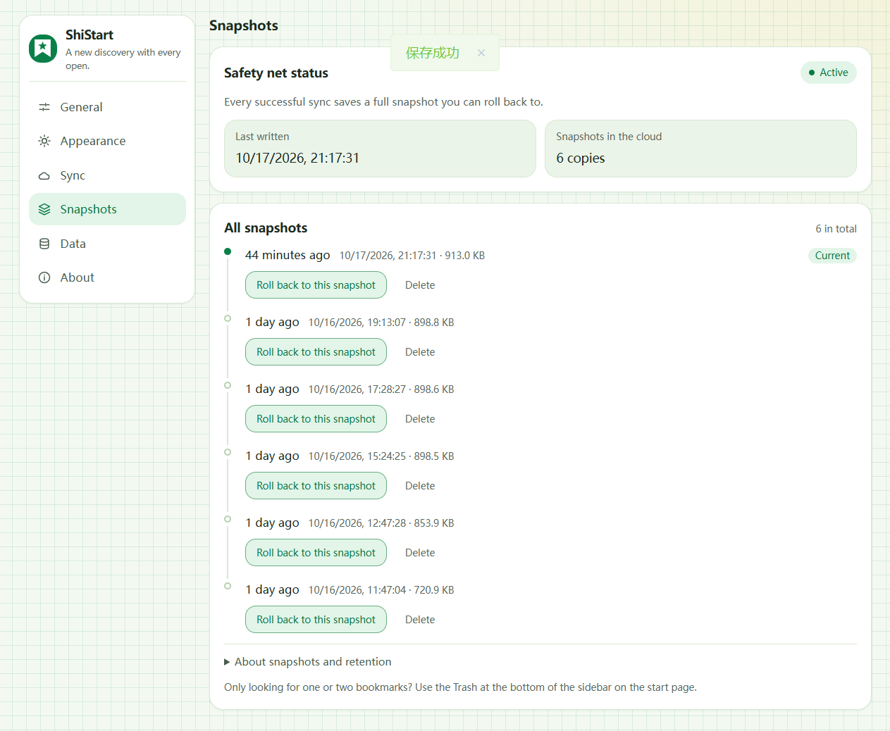
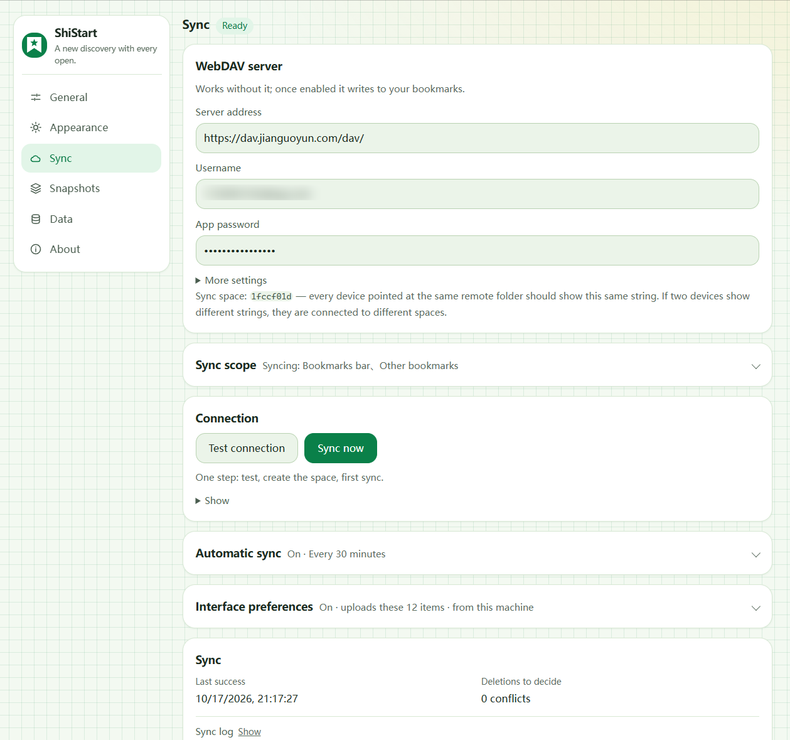

<p align="center"></p>

<h1 align="center">ShiStart</h1>

<p align="center"><em>Every open, a new discovery.</em></p>

<p align="center"><strong>English</strong> · <a href="./README.md">简体中文</a></p>

<p align="center">    </p>

<p align="center"></p>

---

## What it is

A new-tab extension that puts the bookmarks you **already have** in Chrome or Edge
onto the page.

A folder tree on the left, browsable folders on the right — folders with children
render as groups, leaf folders lay out as bookmark cards; search matches **the whole
library**, not just the folder you are in; hover the **right edge** and a "Recently
visited" panel slides out, one click to open in a new tab.

The things that matter, up front:

- **It reads the browser's native bookmark tree** on every new tab. No copy is kept,
  nothing is uploaded (unless you turn sync on — see below).
- **Edits go straight to the native tree**: organizing bookmarks on the page — new
  folder, rename, drag to reorder, delete — writes back to the browser's own
  bookmarks; there is no second copy to fall out of step. Deletions land in the
  in-extension trash first and can be restored within 30 days. **Bookmark import
  is deliberately not offered** — that would open a second write path.
- The UI speaks **Simplified Chinese and English**, following your browser by default.
- Optional **WebDAV sync** keeps bookmarks and UI preferences in step across browsers.
  Off by default; you supply the server and credentials.

## Screenshots

### The home page

With the folder tree collapsed you get this: a folder with children becomes a **group** with
a header, a leaf folder a plain run of cards — one big folder fits on one screen. The search
box at the top matches the **whole library** — a bookmark outside the current folder still
turns up.

<p align="center"></p>

### Light and dark

Same layout, two palettes. The palette button in the top-right corner switches theme and
background pattern; card columns follow the window width, so a wider window simply holds
more.

| Light | Dark |
|---|---|
|  |  |

### The trash

Deleted bookmarks land here first and wait **30 days** — each entry says which folder it
came from and when it was deleted, and *Restore* puts it back where it was: back into the
browser's native tree, not into a copy of it.

<p align="center"></p>

### Snapshots

With sync on, every successful sync leaves a **full snapshot** in the cloud: time, size,
and a *Roll back to this snapshot* button. Sync and snapshots are two different jobs —
sync keeps "now" consistent, snapshots take you back to "then".

Retention: anything from the last 30 days is kept, and older ones are kept up to the most
recent 20. Unchanged content is not stored twice (one copy serves the whole sync space,
distinct content gets one each). Rolling back is **forward-only**: the current state is
saved as a new snapshot first.

<p align="center"></p>

### Sync

Point it at the WebDAV folder you already own (Nutstore, Nextcloud, a Synology box) with
your username and an app password. Three sections fold up underneath: sync scope, automatic
sync, and interface preferences — exactly what would be uploaded, and how often, is written
there; turn it off whenever you like. Leave the address empty and everything stays local.

<p align="center"></p>

## Permissions: five, and only five

| Permission | Why it is needed |
| --- | --- |
| `bookmarks` | Read the bookmark tree for display, folder filtering and local search; edits made on the page (create/rename/drag/delete) are written back through the same permission |
| `favicon` | Show site icons through the browser's own mechanism; falls back to a letter when unavailable |
| `storage` | Store UI preferences (palette, light/dark, background pattern, language, search engine, cards per row, sidebar width, …) |
| `alarms` | Polling for optional sync (every 30 minutes by default) |
| `history` | **Read-only** browsing history, solely for the right-edge "Recently visited" panel: read live, no copy kept, nothing uploaded |

It does **not** request `tabs`, `cookies`, `webRequest`, `<all_urls>`, or any host
permission. No external CDN, no remote fonts, no analytics SDK.

`history` is the only permission that touches user data, so the browser will warn
"read your browsing history" at install time. It is used **only** to list pages you
recently opened; it touches no website's data. You will still see "can't read or
change site data" in the extension menu — that is the expected state.

The WebDAV address is **one you type yourself**; the extension requests permission
for that origin at runtime, and asks for nothing if you never fill it in.

## How to install

The store release is still in preparation. Until then:

1. Download `shistart-<version>-chrome.zip` from this repository's Releases and unzip it
   into a directory **you intend to keep** — the extension reads that directory
   permanently, and deleting it breaks the install.
2. Open `edge://extensions` (Edge) or `chrome://extensions` (Chrome) and enable
   **Developer mode**.
3. Click **Load unpacked** and select the unzipped directory.
4. When Chrome asks "Keep this change?" about the new tab, **click Keep changes** —
   otherwise new tabs keep using the browser's default page.

> Chrome will occasionally show "Please disable extensions running in developer mode".
> That is the browser's standing behaviour for any extension that is not on the store,
> not a fault of this one — it goes away once the store listing is live.

## FAQ

**What is the "ShiStart / Customize Chrome" bar at the bottom?**

Since Chrome 138, when an extension owns the new tab, Chrome injects a **footer of its
own** at the bottom of the page. It is browser UI, not part of our page: the extension
can neither remove it nor restyle it.

To hide it: **right-click** that footer → "Hide footer on new tab"; or go to
Customize Chrome → Footer → toggle it off. (Managed browsers may have this set by an
administrator.)

**New tabs didn't change after installing?**

You must have clicked **Keep changes** on the first-load prompt. Also check that no
other new-tab extension is fighting for the same slot.

**How do I turn sync on?**

Settings → Sync → fill in your WebDAV address and account. It is off by default;
leave it empty and everything stays local. That page lists exactly what would be
uploaded (bookmarks plus 12 UI preferences), and you can turn it off at any time.

**Can I turn off "Recently visited"?**

Yes — Settings → General. It reads your browser's own history and keeps no copy.

**Will snapshots pile up forever?**

No, they converge on their own: everything from the last 30 days stays, older ones are
kept up to the most recent 20 and the rest are cleaned up. Snapshots only exist with sync
on; without it the page is empty. Deleting one is **shared** — delete it here and the other
devices lose it too, so think twice before removing what might be the only safety net
elsewhere.

**Can I export my bookmarks and settings?**

Yes — Settings → Data exports bookmarks (HTML / JSON) and a settings backup.

## Build from source

```bash
pnpm install     # install dependencies (pnpm 11)
pnpm build       # build into .output/chrome-mv3
pnpm zip         # package a zip for store upload
```

Then follow step 2 of "How to install" above, loading `.output/chrome-mv3` as the
unpacked directory. `pnpm compile` runs the type check and `pnpm test` the pure-function
unit tests.

## Changelog

See [CHANGELOG.md](./CHANGELOG.md). Privacy policy: [PRIVACY.md](./PRIVACY.md).

## ☕ Support the author

If ShiStart has saved you an afternoon, you can buy the author a coffee — thank you,
it keeps the project going.

| Alipay | WeChat Pay |
|---|---|
|  |  |

## License & notes

ShiStart is open source under the **MIT license** — see [LICENSE](./LICENSE).

## 📮 Contact

- Website: [shixiongzhidao.cn](https://shixiongzhidao.cn)
- GitHub & Gitee: [GitHub](https://github.com/ShiXiongZhiDao/ShiStart) ·
  [Gitee](https://gitee.com/ShiXiongZhiDao/ShiStart)
- WeChat channel: **师兄知道** (ShiXiongZhiDao) — the same one shown on the
  extension's About page


