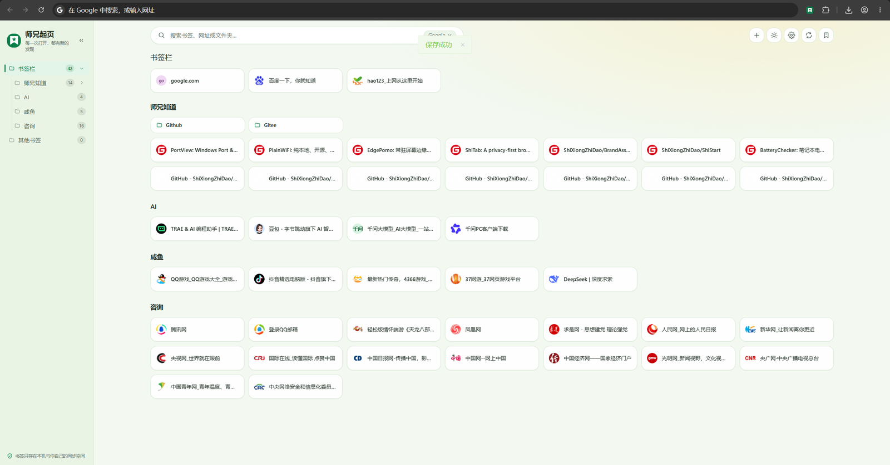
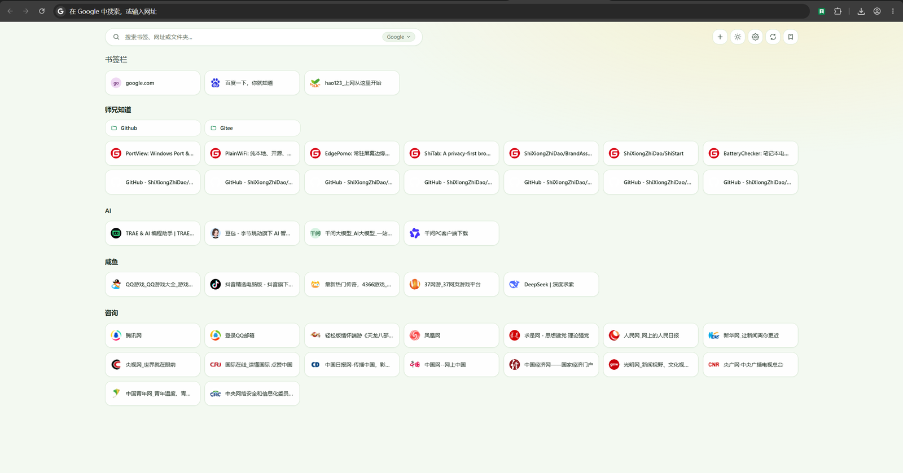
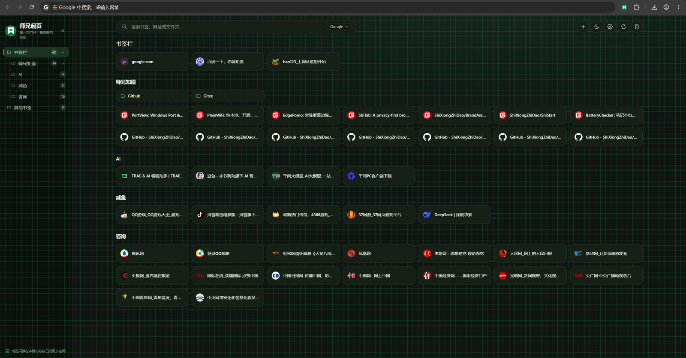
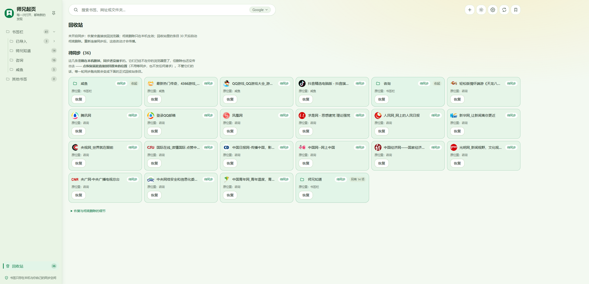
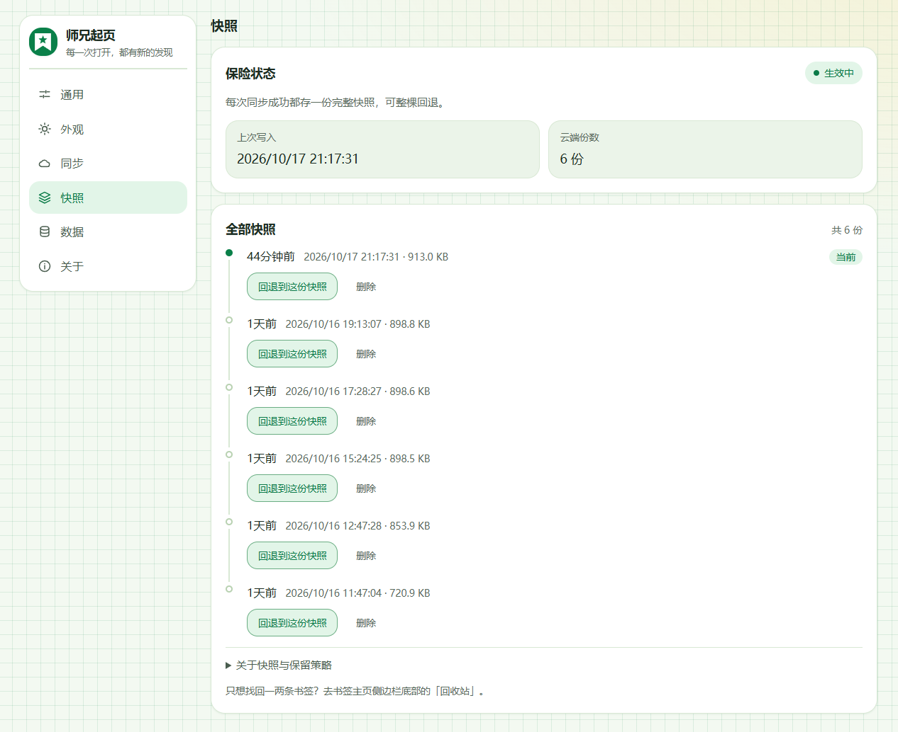
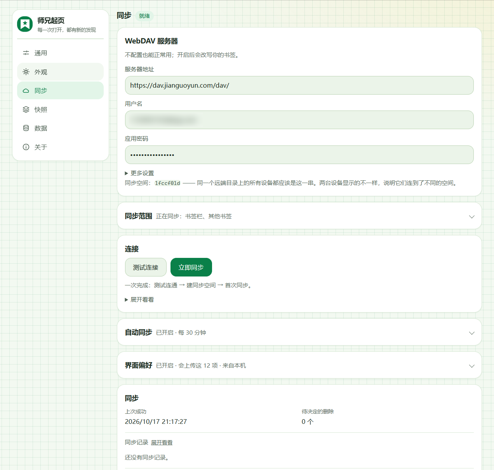

<p align="center"></p>

<h1 align="center">师兄起页 ShiStart</h1>

<p align="center"><em>每一次打开，都有新的发现。</em></p>

<p align="center"><a href="./README.en.md">English</a> · <strong>简体中文</strong></p>

<p align="center">    </p>

<p align="center"></p>

---

## 它能做什么

- **开一个新标签页，就是你的书签。** 不导入、不新建、不复制：页面上铺的就是浏览器里那棵树，每次打开实时读一遍。
- **左边是目录树，和书签管理器里那棵一样。** 逐层展开，进到哪层都能从面包屑跳回去；侧边栏默认收起，鼠标碰到左缘浮出来，也能拖宽。
- **有子目录的文件夹按分组铺开。** 一节一个文件夹标题加数量，里面再放文件夹块或书签卡片；叶子目录直接平铺卡片 —— 一个大目录一屏能看完。
- **搜索是全库的。** 不在当前文件夹里的书签也找得到；`Ctrl / Cmd + K` 或 `/` 聚焦搜索框，`Esc` 清空。没搜到就直接拿这个词去搜索引擎。
- **在页面上直接把书签整理好。** 新建文件夹、改名、拖拽排序、改归属、删除 —— 都写回浏览器原生书签，不存在"两份以谁为准"。
- **删错了能捡回来。** 删除先进回收站，30 天内按原位恢复；恢复文件夹会把它里面的书签一起带回来。
- **一次处理一批。** 勾选多个书签或文件夹，一次性打开、移动、删除；批量删除会先问一句。
- **鼠标移到右缘，「最近访问」浮出来。** 读的是浏览器自己的历史：只读、不留副本、不上传。
- **右键还有别的开法。** 新窗口、无痕窗口、Edge 分屏，或者只复制链接。
- **界面跟着你走。** 两套配色 × 明暗、三种纸纹、每行 4–12 张卡片、中英双语，都记在偏好里。
- **想跨设备就接自己的 WebDAV。** 坚果云、Nextcloud、群晖都行；不填地址就是纯本机，一个请求都不发。

## 它不是什么

- **不是书签管理器的替代品。** 查重、修死链、批量导入导出这类"整理档案"的活它不做 —— 那些自带管理器或专门工具更合适。它管的是"看和用"。
- **不提供「导入书签」。** 书签只有一份，就是浏览器那棵树。多一条写入通道，就多一个"两边不一样"的来源。
- **没有作者的服务器。** 没有账号、没有遥测。要同步，用你自己的 WebDAV。
- **不是拨号页。** 不会替你生成一堆图标，也不改你的书签；你看到的就是你存下来的。
- **不读你访问的网页。** 唯一碰用户数据的权限是浏览历史，只用来列"最近访问"。

## 为什么做这个

浏览器自带的书签管理器是个**归档**的地方：要专门打开一个页面，再一层层点进去。
书签栏倒是常在，但只有一条 —— 文件夹攒到十几个，就只剩一排看不出区别的小图标。

于是收藏这个动作几乎没有回访：存的时候觉得"以后有用"，之后再没点开过。

所以它长在**新标签页**上。那是浏览器里唯一一个不用特意去、每天都会经过几十次的位置：
打开就看到，看到就能点走。

代价很直接：它要接管你的新标签页。第一次加载时 Chrome / Edge 会问一句
「是否保留此更改」，必须点保留，否则新标签页照旧走浏览器默认页。

## 为什么书签只有一份

多数书签类扩展会先建一份自己的库：导入一次，从此它管那一份。以后每次操作都要回答
"以谁为准"。

这里反过来：**浏览器原生书签树是唯一数据源**，页面只负责展示和就地修改。取舍是明摆着的：

- 没有"同步副本"的问题 —— 在页面上改，就是改浏览器里的；
- 但**不能导入书签**，也不能把书签存到别处 —— 那是第二条写入通道；
- 删除不是直接消失，先落进回收站（30 天）；恢复是写回原生树，不是写回副本。

需要跨设备时，同步的也是这棵树加上界面偏好，服务器由你自己提供。

## 和常见的三种用法比

| | 浏览器自带管理器 | 书签栏 | 师兄起页 |
| --- | --- | --- | --- |
| 什么时候看得见 | 专门打开一个页面 | 常驻，但只有一条 | 每次开新标签页 |
| 层级 | 树，逐层点 | 只能一层 | 树 + 分组铺开 + 面包屑 |
| 搜索 | 全库 | 没有 | 全库；在回收站里搜当前这一屏 |
| 删除 | 没有回收站 | 没有回收站 | 30 天内可按原位恢复 |
| 数据在哪 | 浏览器 | 浏览器 | 浏览器；可选同步到你自己的 WebDAV |
| 要注册账号吗 | 不用 | 不用 | 不用 |

## 界面一览

### 主页

带下层文件夹的按**分组**铺开，叶子目录直接平铺卡片 —— 目录树收起来时就是这样，
一屏能看完一个大目录。顶部搜索框是**全库匹配**，不在当前文件夹里的书签也能搜到。

<p align="center"></p>

### 浅色与深色

同一套布局，两套配色。右上角那排图标里，调色板按钮切换主题与背景图案；
卡片列数跟着窗口宽度走，宽了就多排几列。

| 浅色 | 深色 |
|---|---|
|  |  |

### 回收站

删除的书签先进回收站，**30 天内可恢复**。每条都写着它原本在哪个目录、什么时候删的，
点「恢复」就回到原位 —— 回到浏览器原生书签树里，不是回到一份副本里。

<p align="center"></p>

### 快照

开了同步之后，每次同步成功都会在云端留一份**完整快照**：列着时间与体积，
可以整棵回退到某一版。同步和快照是分开的两件事 —— 同步管「现在一致」，
快照管「回到从前」。

保留策略：30 天以内的一律留着，更早的最多再留最近 20 份。内容没变不会重复存
（同一个同步空间共用一份，不同的内容各占一份）。回退是**前进式**的，
动手之前会先把当前状态另存一份。

<p align="center"></p>

### 同步

填上你自己那个 WebDAV 地址、用户名、应用密码就行（坚果云、Nextcloud、群晖都行）。
下面三块折叠着：同步范围、自动同步、界面偏好 —— 会上传什么、多久传一次，都在里面写清楚，
随时可以关掉。不填地址就是纯本机使用。

<p align="center"></p>

## 权限：只申请五项

| 权限 | 为什么需要 |
| --- | --- |
| `bookmarks` | 读取书签树，用于展示、按文件夹筛选、本地搜索；在主页里整理书签（新建/改名/拖拽/删除）也通过它写回浏览器书签 |
| `favicon` | 用浏览器自带的机制显示站点图标；取不到时用文字回退 |
| `storage` | 保存界面偏好（配色、明暗、背景图案、语言、搜索引擎、每行卡片数、侧边栏宽度等） |
| `alarms` | 可选同步的定时轮询（默认每 30 分钟） |
| `history` | **只读**浏览历史，只为右缘那个「最近访问」面板：实时读、不另存副本、不上传 |

不申请 `tabs`、`cookies`、`webRequest`、`<all_urls>`，也不加载外部 CDN、远程字体
和统计 SDK。

`history` 是唯一一个「读用户数据」的权限，安装时浏览器会提示「读取您的浏览历史」——
它只用来显示最近打开过的网页，**不碰任何网站的数据**。除此之外，扩展菜单里仍会显示
「无法读取或更改网站的数据」，那是预期状态。

同步用的服务器地址是**你自己填的**，扩展按最小来源在运行时申请权限；不填就不申请。

## 怎么装上

**最省事**：Chrome 应用商店里搜「师兄起页」，装完即用。

**要装最新一版**（商店审核有延迟，Releases 里的安装包永远是最新那一版）：

1. 从本仓库的 Releases 下载 `shistart-<版本>-chrome.zip`，解压到一个**以后会留着**的目录
   （扩展会一直读那个目录，删了它就失效了）。
2. Edge 打开 `edge://extensions`、Chrome 打开 `chrome://extensions`，打开右上/右下角的
   **开发者模式**。
3. 点「加载未打包的扩展程序」，选中解压出来的目录。
4. Chrome 弹出「已替换新标签页，是否保留此更改」时，**必须点「保留更改」**，
   否则新标签页仍旧走浏览器默认页。

> Chrome 会不时提示「请停用以开发者模式运行的扩展程序」。那是浏览器对**开发者模式
> 加载**的固定行为，不是本扩展的问题 —— 从商店装的不会看到它。

## 常见问题

**底部那条「师兄起页 - 书签主页 / 自定义 Chrome」是什么？**

Chrome 138 起，新标签页被扩展接管时，Chrome 会在页面底部插入一条**浏览器自己的页脚**。
它是浏览器 UI，不在我们的页面里，扩展既不能删也不能改它的样式。

要隐藏它：在那条页脚上**右键** → 「在新标签页上隐藏页脚」；或走 自定义 Chrome → 页脚 →
关闭开关。（企业策略管理的浏览器可能由管理员统一控制。）

**装了之后新标签页没变？**

第一次加载扩展时那条「是否保留此更改」的提示**必须点「保留更改」**。另外确认没有其他
新标签页类扩展在抢同一个位置。

**怎么开同步？**

设置页 → 同步 → 填上 WebDAV 地址与账号。默认关闭，不填就是纯本机使用。
那一页列全了会上传什么（书签 + 12 项界面偏好），可以随时关掉。

**右缘的「最近访问」能关吗？**

能。设置页 → 通用。它读的是浏览器自己的历史，不留副本。

**快照会一直堆着吗？**

会自己收敛。30 天以内的一律留着，更早的最多再留最近 20 份，其余自动清掉。
快照只在开了同步之后才有，纯本机使用时它就是空的。删一份是**共享**的 ——
你在这里删了，别的设备也看不到，所以删之前想一下它是不是别处唯一的保险。

**书签和设置能导出吗？**

能。设置页 → 数据，可导出书签（HTML / JSON）与设置备份。

## 从源码构建

```bash
pnpm install     # 装依赖（pnpm 11）
pnpm build       # 构建到 .output/chrome-mv3
pnpm zip         # 打成安装包（发版流水线会自动提交商店审核）
```

然后照上面「怎么装上」从第 2 步起，把 `.output/chrome-mv3` 当未打包目录加载进去。
`pnpm compile` 是类型检查，`pnpm test` 是纯函数单测。

## 更新记录

见 [CHANGELOG.md](./CHANGELOG.md)。隐私说明见 [PRIVACY.md](./PRIVACY.md)。

## ☕ 支持作者

如果师兄起页帮你省下了一个下午，可以请作者喝杯咖啡 —— 谢谢你，这让项目能继续走下去。

| 支付宝 | 微信支付 |
|---|---|
|  |  |

## 许可与声明

师兄起页以 **MIT 授权**开源 —— 见 [LICENSE](./LICENSE)。

## 📮 联系

- 个人网站：[shixiongzhidao.cn](https://shixiongzhidao.cn)
- GitHub & Gitee：[GitHub](https://github.com/ShiXiongZhiDao/ShiStart) ·
  [Gitee](https://gitee.com/ShiXiongZhiDao/ShiStart)
- 公众号：**师兄知道** —— 扩展的关于页里也是这一个


